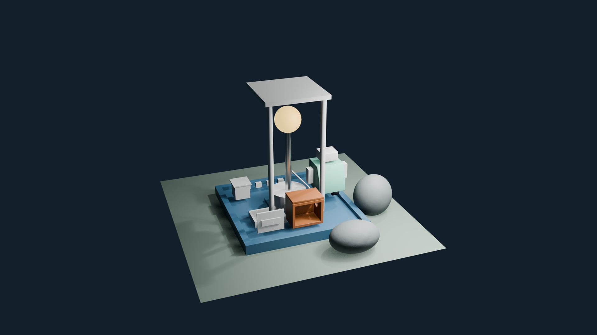

# Lecture 5: Materials, Procedural Shaders & Surface Behavior

Build the Lumen Field Station’s material palette and test paint, rubber, metal, glass and procedural surfaces under controlled light. The lecture explains shared materials and face slots, Principled controls, node connections, reusable groups, roughness, bump, displacement, thin sheets and color management. Separate studies keep each comparison visible.

The lecture is 1:12:51. Its video link will be added when published. [Full course playlist](https://www.youtube.com/playlist?list=PLYUs-JVhJLWg) · [course overview](https://github.com/FurkanGozukara/Blender-Full-Tutorial-Lecture-2026-2027) · [concept guide](LECTURE_05_GUIDE.md)

## Open and continue

The files use Blender 5.2.2 LTS. Keep the folders together so relative image paths resolve. Open `extras/w05_inputs.blend` for the continuing station, or use a supplied lab for a comparison. To preserve your own workspace layout, disable **Load UI** in File > Open. Save a new working copy before editing.

The optional scripts recreate the supplied examples in `extras/generated/`; they are not needed to use the included scenes. [Supplied examples and script instructions](extras/README.md).

## Files made in the lesson

Times identify the beginning of the save instruction. The saved result includes the completed action.

| File | Save instruction |
|---|---|
| [w05_slots_result.blend](LumenCourse/blend/w05_slots_result.blend) | 8:18 |
| [w05_station_materials.blend](LumenCourse/blend/w05_station_materials.blend) | 10:49 |
| [w05_station_palette.blend](LumenCourse/blend/w05_station_palette.blend) | 20:56 |
| [w05_surface_variation.blend](LumenCourse/blend/w05_surface_variation.blend) | 35:08 |
| [w05_station_surface_detail.blend](LumenCourse/blend/w05_station_surface_detail.blend) | 41:57 |
| [w05_displacement_comparison.blend](LumenCourse/blend/w05_displacement_comparison.blend) | 45:25 |
| [w05_stylized_light.blend](LumenCourse/blend/w05_stylized_light.blend) | 49:21 |
| [w05_station_v001.blend](LumenCourse/blend/w05_station_v001.blend) | 50:42 |
| [w05_thinwall_tag_study.blend](LumenCourse/blend/w05_thinwall_tag_study.blend) | 56:29 |
| [w05_color_pipeline.blend](LumenCourse/blend/w05_color_pipeline.blend) | 1:00:35 |
| [w05_reference_recreation.blend](LumenCourse/blend/w05_reference_recreation.blend) | 1:07:31 |
| [w05_procedural_and_images.blend](LumenCourse/blend/w05_procedural_and_images.blend) | 1:10:24 |
| [w05_station_final.blend](LumenCourse/blend/w05_station_final.blend) | 1:12:17 |

[Final station render](LumenCourse/renders/w05_material_overview_final.png) · [all texture dependencies](LumenCourse/textures/)

## Catch-up checkpoints

Each checkpoint is the state after its named chapter. Open it, save a personal copy, then continue from the time in the last column. The last checkpoint is the end state to keep for Lecture 6.

| Checkpoint | Completed step | Continue at |
|---|---|---|
| [01](checkpoints/w05_checkpoint_01_read_a_surface_under_fixed_light.blend) | Read a surface under fixed light | 2:30 |
| [02](checkpoints/w05_checkpoint_02_make_the_preview_lighting_explicit.blend) | Make the preview lighting explicit | 3:58 |
| [03](checkpoints/w05_checkpoint_03_create_and_share_the_painted_housing.blend) | Create and share the painted housing | 6:35 |
| [04](checkpoints/w05_checkpoint_04_make_a_deliberate_copy_and_teach_material_slots.blend) | Make a deliberate copy and teach material slots | 7:20 |
| [05](checkpoints/w05_checkpoint_05_assign_a_material_to_a_face_region.blend) | Assign a material to a face region | 8:33 |
| [06](checkpoints/w05_checkpoint_06_give_the_courier_rubber_and_the_fitting_metal.blend) | Give the courier rubber and the fitting metal | 11:04 |
| [07](checkpoints/w05_checkpoint_07_isolate_paint_and_metal_response.blend) | Isolate paint and metal response | 14:10 |
| [08](checkpoints/w05_checkpoint_08_separate_coating_from_the_underlying_surface.blend) | Separate coating from the underlying surface | 15:25 |
| [09](checkpoints/w05_checkpoint_09_inspect_thick_transmission.blend) | Inspect thick transmission | 17:36 |
| [10](checkpoints/w05_checkpoint_10_use_subsurface_scattering_at_the_object_scale.blend) | Use subsurface scattering at the object scale | 19:34 |
| [11](checkpoints/w05_checkpoint_11_refine_the_station_signal_and_material_families.blend) | Refine the station signal and material families | 21:14 |
| [12](checkpoints/w05_checkpoint_12_connect_coordinates_mapping_and_noise_by_hand.blend) | Connect coordinates, mapping and noise by hand | 24:00 |
| [13](checkpoints/w05_checkpoint_13_predict_the_direction_of_coordinate_scaling.blend) | Predict the direction of coordinate scaling | 25:34 |
| [14](checkpoints/w05_checkpoint_14_convert_a_scalar_into_a_controlled_range.blend) | Convert a scalar into a controlled range | 29:16 |
| [15](checkpoints/w05_checkpoint_15_name_the_arithmetic_and_mixing_utilities.blend) | Name the arithmetic and mixing utilities | 31:41 |
| [16](checkpoints/w05_checkpoint_16_package_the_understood_roughness_branch.blend) | Package the understood roughness branch | 35:25 |
| [17](checkpoints/w05_checkpoint_17_give_the_rock_restrained_roughness_and_bump.blend) | Give the rock restrained roughness and bump | 39:49 |
| [18](checkpoints/w05_checkpoint_18_compare_cloudy_and_cellular_patterns.blend) | Compare cloudy and cellular patterns | 42:15 |
| [19](checkpoints/w05_checkpoint_19_compare_bump_with_actual_displaced_geometry.blend) | Compare bump with actual displaced geometry | 45:42 |
| [20](checkpoints/w05_checkpoint_20_build_a_separate_banded_light_material.blend) | Build a separate banded-light material | 49:38 |
| [21](checkpoints/w05_checkpoint_21_save_the_material_baseline.blend) | Save the material baseline | 51:00 |
| [22](checkpoints/w05_checkpoint_22_read_the_thin_sheet_geometry_before_enabling_thin_wall.blend) | Read the thin-sheet geometry before enabling Thin Wall | 53:59 |
| [23](checkpoints/w05_checkpoint_23_transfer_the_sheet_material_and_keep_an_opaque_fallback.blend) | Transfer the sheet material and keep an opaque fallback | 56:46 |
| [24](checkpoints/w05_checkpoint_24_separate_rendered_values_from_their_display.blend) | Separate rendered values from their display | 59:27 |
| [25](checkpoints/w05_checkpoint_25_interpret_textures_and_preserve_the_working_space.blend) | Interpret textures and preserve the working space | 1:00:52 |
| [26](checkpoints/w05_checkpoint_26_judge_the_palette_at_the_size_it_will_be_seen.blend) | Judge the palette at the size it will be seen | 1:01:56 |
| [27](checkpoints/w05_checkpoint_27_diagnose_the_surface_before_changing_a_random_slider.blend) | Diagnose the surface before changing a random slider | 1:03:38 |
| [28](checkpoints/w05_checkpoint_28_recreate_the_broad_qualities_of_an_original_reference.blend) | Recreate the broad qualities of an original reference | 1:07:50 |
| [29](checkpoints/w05_checkpoint_29_compare_procedural_nodes_with_saved_image_maps.blend) | Compare procedural nodes with saved image maps | 1:10:41 |
| [30](checkpoints/w05_checkpoint_30_preview_uvs_and_preserve_the_next_lecture_s_inputs.blend) | Preview UVs and preserve the next lecture’s inputs | Lecture complete; keep for Lecture 6 |

## Check the final station

Values below were read from `LumenCourse/blend/w05_station_final.blend`. Unit system: **METRIC**, scale **1**. Dimensions are the saved scene’s evaluated dimensions. Hidden backups and independent studies remain available; their complete table is in [SCENE_REFERENCE.md](SCENE_REFERENCE.md).

| Object | Collections | Location X, Y, Z | Dimensions X, Y, Z | Materials | Viewport / render |
|---|---|---|---|---|---|
| CR_arm_L | COLLECTION_COURIER | 0.44, 0, 0.88 | 0.1, 0.14, 0.3 | — | visible / enabled |
| CR_arm_R | COLLECTION_COURIER | 1.16, 0, 0.88 | 0.1, 0.14, 0.3 | — | visible / enabled |
| CR_axle | COLLECTION_COURIER | 0.8, 0, 0.3 | 0.07, 0.07, 0.5 | — | visible / enabled |
| CR_body | COLLECTION_COURIER | 0.8, 0, 0.695 | 0.55, 0.55, 0.55 | MAT_Courier | visible / enabled |
| CR_chassis | COLLECTION_COURIER | 0.8, 0, 0.4 | 0.2, 0.1, 0.2 | — | visible / enabled |
| CR_foot_L | COLLECTION_COURIER | 0.62, 0, 0.3 | 0.2, 0.2, 0.12 | MAT_Rubber | visible / enabled |
| CR_foot_R | COLLECTION_COURIER | 0.98, 0, 0.3 | 0.2, 0.2, 0.12 | MAT_Rubber | visible / enabled |
| CR_head | COLLECTION_COURIER | 0.8, 0, 1.12 | 0.34, 0.3, 0.18 | — | visible / enabled |
| CR_neck | COLLECTION_COURIER | 0.8, 0, 0.99 | 0.11, 0.11, 0.08 | — | visible / enabled |
| GEO_BeaconBase | STATION | 0, 0, 0.35 | 0.7, 0.7, 0.3 | — | visible / enabled |
| GEO_BeaconPost | STATION | 0, 0, 1.1 | 0.12, 0.12, 1.2 | MAT_ExposedMetal | visible / enabled |
| GEO_BracketSource | CAMERAS_LIGHTS | -0.6, 0.85, 0.25 | 0.84, 0.08, 0.1 | — | visible / enabled |
| GEO_CargoBox | STATION | -0.8, 0.6, 0.35 | 0.3, 0.3, 0.3 | — | visible / enabled |
| GEO_CargoCover | CAMERAS_LIGHTS | -0.8, 0.6, 0.52 | 0.36, 0.36, 0.02 | — | visible / enabled |
| GEO_DockingTray | CAMERAS_LIGHTS | -0.5, -0.35, 0.185 | 0.62, 0.45, 0.13 | — | visible / enabled |
| GEO_EquipmentHousing | CAMERAS_LIGHTS | 0, -0.75, 0.45 | 0.6, 0.4, 0.5 | MAT_PaintedShell | visible / enabled |
| GEO_Ground | ENVIRONMENT | 0, 0, 0 | 4, 4, 0 | — | visible / enabled |
| GEO_HousingLid | CAMERAS_LIGHTS | 0.05, -0.75, 0.73 | 0.6, 0.4, 0.04 | MAT_PaintedLid | visible / enabled |
| GEO_HousingPanel | CAMERAS_LIGHTS | -0.65, -0.9, 0.42 | 0.5, 0.035, 0.4 | — | visible / enabled |
| GEO_Nameplate | CAMERAS_LIGHTS | -0.65, -0.9175, 0.42 | 0.36, 0.024, 0.12 | — | visible / enabled |
| GEO_Platform | STATION | 0, 0, 0.1 | 2.4, 2.4, 0.2 | MAT_Platform | visible / enabled |
| GEO_Rock | W04_INPUTS | 1.55, -0.55, 0.36 | 0.7789, 0.6631, 0.86 | MAT_Stone | visible / enabled |
| GEO_Rock_Second | W04_INPUTS | 0.65, -1.65, 0.26 | 0.9346, 0.6631, 0.559 | MAT_Stone | visible / enabled |
| GEO_RoofPost_L | STATION | -0.5, -0.5, 1.35 | 0.1, 0.1, 2.3 | — | visible / enabled |
| GEO_RoofPost_R | STATION | 0.5, -0.5, 1.35 | 0.1, 0.1, 2.3 | — | visible / enabled |
| GEO_RoofSlab | STATION | 0, 0, 2.5 | 1.2, 1.2, 0.08 | — | visible / enabled |
| GEO_SignalHead | STATION | 0, 0, 1.95 | 0.5, 0.5, 0.5 | MAT_Signal | visible / enabled |
| GEO_StationCable | CAMERAS_LIGHTS | 0, 0, 0 | 0.4225, 0.7087, 0.4884 | — | visible / enabled |
| GEO_Terrain | W04_INPUTS | 0, 0, 0.002 | 4.4, 4.4, 0.0419 | W04_Terrain_Clay | visible / enabled |

### Camera, light and display

| Item | Saved values |
|---|---|
| `Area` | AREA; location 2, -2, 3; energy 500; color #FFFFFF; size 2 |
| Active camera `Camera` | Location -3.244, -9.4416, 5.7606; rotation 64.3556, -0.0001, -20.0888 degrees; lens 35 mm |
| `Light` | POINT; location 4.0762, 1.0055, 5.9039; energy 1000; color #FFFFFF |
| Render | BLENDER_EEVEE; 3840 × 2160 at 100% |
| Display | sRGB; AgX; Look None; Exposure 0; Gamma 1 |

Light energy units depend on the light type; these are direct Blender RNA values. The lecture’s separate labs intentionally use their own engines and lighting. The current material values below are endpoint values; earlier comparisons deliberately differ. Hex colors are display-encoded sRGB equivalents of the unlinked scene-linear Base Color inputs. Linked inputs are governed by their node paths.

| Material | Base Color | Metallic | Roughness | Transmission | Coat | Emission strength |
|---|---|---|---|---|---|---|
| MAT_Courier | #83DAC2 | 0 | 0.5 | 0 | 0 | 0 |
| MAT_ExposedMetal | #E7E7E7 | 1 | 0.25 | 0 | 0 | 0 |
| MAT_PaintedLid | #AD6334 | 0 | 0.6 | 0 | 0 | 0 |
| MAT_PaintedShell | #AD6334 | 0 | 0.4 | 0 | 0 | 0 |
| MAT_Platform | #3F6D8E | 0 | 0.5 | 0 | 0 | 0 |
| MAT_Rubber | #30343A | 0 | 0.75 | 0 | 0 | 0 |
| MAT_Signal | #FFB347 | 0 | 0.5 | 0 | 0 | 2 |
| MAT_Stone | #777E82 | 0 | Linked node input | 0 | 0 | 0 |
| W04_Terrain_Clay | #738479 | 0 | 0.65 | 0 | 0 | 0 |

## Chapters

- 0:00 Read a surface under fixed light
- 2:30 Make the preview lighting explicit
- 3:58 Create and share the painted housing
- 6:35 Make a deliberate copy and teach material slots
- 7:20 Assign a material to a face region
- 8:33 Give the courier rubber and the fitting metal
- 11:04 Isolate paint and metal response
- 14:10 Separate coating from the underlying surface
- 15:25 Inspect thick transmission
- 17:36 Use subsurface scattering at the object scale
- 19:34 Refine the station signal and material families
- 21:14 Connect coordinates, mapping and noise by hand
- 24:00 Predict the direction of coordinate scaling
- 25:34 Convert a scalar into a controlled range
- 29:16 Name the arithmetic and mixing utilities
- 31:41 Package the understood roughness branch
- 35:25 Give the rock restrained roughness and bump
- 39:49 Compare cloudy and cellular patterns
- 42:15 Compare bump with actual displaced geometry
- 45:42 Build a separate banded-light material
- 49:38 Save the material baseline
- 51:00 Read the thin-sheet geometry before enabling Thin Wall
- 53:59 Transfer the sheet material and keep an opaque fallback
- 56:46 Separate rendered values from their display
- 59:27 Interpret textures and preserve the working space
- 1:00:52 Judge the palette at the size it will be seen
- 1:01:56 Diagnose the surface before changing a random slider
- 1:03:38 Recreate the broad qualities of an original reference
- 1:07:50 Compare procedural nodes with saved image maps
- 1:10:41 Preview UVs and preserve the next lecture’s inputs

## Links and next lecture

- [Blender download](https://www.blender.org/download/)
- [Blender manual](https://docs.blender.org/manual/en/latest/)
- [Screencast Keys](https://github.com/nutti/Screencast-Keys), the on-screen key display; no add-on is included.

Lecture 6 continues with UVs, texture painting, baking and transferable texture sets. Keep the final station, the separate procedural/image example and their image dependencies together.
