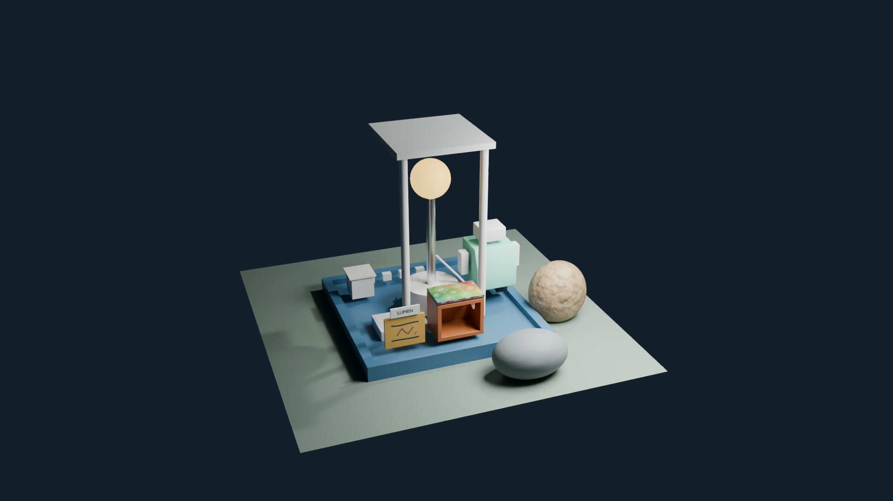

# Lecture 6: UVs, Texture Painting, Baking, Texture Sets & UDIMs

Give the Lumen Field Station housing an authored label and its rock a baked texture set. The lecture unwraps the panel, the lid and the rock receiver, paints and saves a label, bakes a normal map and a base color from a high-detail source, adds roughness and metallic maps, a transparent decal and a two-tile UDIM image, and checks that every saved image reopens.

The lecture is 1:02:39. Its video link will be added when published. [Full course playlist](https://www.youtube.com/playlist?list=PLYUs-JVhJLWg) · [course overview](https://github.com/FurkanGozukara/Blender-Full-Tutorial-Lecture-2026-2027) · [concept guide](LECTURE_06_GUIDE.md)

## Open and continue

The files use Blender 5.2.2 LTS. Keep the folders together so relative image paths resolve. Open `extras/w06_station_start.blend` for the station the lecture begins with, save a working copy into `LumenCourse/blend/`, and follow the video. To preserve your own workspace layout, disable **Load UI** in File > Open. Save a new working copy before editing a checkpoint.

[About the supplied start station](extras/README.md) · [every object of the final scene](SCENE_REFERENCE.md)

## Files made in the lesson

Times identify the beginning of the save instruction. The saved result includes the completed action. The scenes were re-saved for this download with relative image paths; their contents are the lecture states.

| File | Save instruction |
|---|---|
| [station_label_color.png](LumenCourse/textures/station_label_color.png) | 13:29 blank image, 20:00 painted label, 22:07 wear marks (the file is the last version) |
| [w06_station_v001.blend](LumenCourse/blend/w06_station_v001.blend) | 20:14 |
| [w06_station_prebake.blend](LumenCourse/blend/w06_station_prebake.blend) | 27:47 |
| [rock_normal.png](LumenCourse/textures/rock_normal.png) | 30:36 |
| [rock_basecolor.png](LumenCourse/textures/rock_basecolor.png) | 38:16 |
| [rock_roughness.png](LumenCourse/textures/rock_roughness.png) | 42:28 |
| [rock_metallic.png](LumenCourse/textures/rock_metallic.png) | 43:54 |
| [station_decal.png](LumenCourse/textures/station_decal.png) | 49:52 |
| [station_tiles.1001.png](LumenCourse/textures/station_tiles.1001.png) and [station_tiles.1002.png](LumenCourse/textures/station_tiles.1002.png) | 53:30 |
| [w06_station_final.blend](LumenCourse/blend/w06_station_final.blend) | 1:00:43 |

All images are in [LumenCourse/textures](LumenCourse/textures/); the scenes are in [LumenCourse/blend](LumenCourse/blend/). `w06_station_v001.blend`, checkpoint 4 and checkpoint 5 hold the label as painted in part 4 inside the scene file; `station_label_color.png` is the later version with the wear marks, which the scenes of parts 6 to 8 read.

## Catch-up checkpoints

Each checkpoint is the state at the end of its lecture part. Open it, save a personal copy, then continue from the time in the last column. The last checkpoint is the end state to keep for Lecture 7.

| Checkpoint | Completed step | Continue at |
|---|---|---|
| [01](checkpoints/w06_checkpoint_01_texture_contract_start.blend) | Texture contract and the checker | 2:54 |
| [02](checkpoints/w06_checkpoint_02_seams_and_unwrap.blend) | Seams and unwrap | 9:12 |
| [03](checkpoints/w06_checkpoint_03_checked_and_packed_uvs.blend) | Packed and shared coordinates | 12:59 |
| [04](checkpoints/w06_checkpoint_04_painted_label.blend) | Painted label | 19:44 |
| [05](checkpoints/w06_checkpoint_05_saved_scene_and_pixels.blend) | Saved scene and external pixels | 21:22 |
| [06](checkpoints/w06_checkpoint_06_aligned_bake_receiver.blend) | Aligned bake receiver | 28:10 |
| [07](checkpoints/w06_checkpoint_07_baked_maps_decal_and_udim.blend) | Baked texture set, transparent decal and two-tile variation | 55:08 |
| [08](checkpoints/w06_checkpoint_08_final_dependency_checked_station.blend) | Final dependency-checked station | Lecture complete; keep for Lecture 7 |

## Check the final station

Values below were read from `LumenCourse/blend/w06_station_final.blend`. Unit system: **METRIC**, scale **1**. Dimensions are the saved scene's evaluated dimensions. Hidden backups and comparison studies remain in the file; the complete table is in [SCENE_REFERENCE.md](SCENE_REFERENCE.md).

| Object | Collections | Location X, Y, Z | Dimensions X, Y, Z | Materials | UV map | Viewport / render |
|---|---|---|---|---|---|---|
| GEO_HousingPanel | CAMERAS_LIGHTS | -0.65, -0.9, 0.42 | 0.5, 0.035, 0.4 | MAT_StationLabel | 6 faces, 9 seams | visible / enabled |
| GEO_Nameplate | CAMERAS_LIGHTS | -0.65, -0.9175, 0.7 | 0.36, 0.024, 0.12 | — | 6 faces, 0 seams | visible / enabled |
| GEO_HousingLid | CAMERAS_LIGHTS | 0.05, -0.75, 0.73 | 0.6, 0.4, 0.04 | MAT_Lid_Checker | 6 faces, 9 seams | visible / enabled |
| BAKE_rock_low | BAKE_TARGET | 1.55, -0.55, 0.36 | 0.7789, 0.6631, 0.86 | MAT_Rock_Export | 1280 faces, 0 seams | visible / enabled |
| BAKE_rock_high | BAKE_SOURCE | 1.55, -0.55, 0.36 | 0.7793, 0.6648, 0.8668 | MAT_PreparedHighGeometry | 5120 faces, 0 seams | visible / hidden |
| BACKUP_rock_low_W06 | BAKE_TARGET | 1.55, -0.55, 0.36 | 0.7789, 0.6631, 0.86 | MAT_Stone | 1280 faces, 0 seams | visible / hidden |
| STUDY_rock_procedural | BAKE_TARGET | 2.65, -0.55, 0.36 | 0.7789, 0.6631, 0.86 | MAT_Rock_Procedural | 1280 faces, 0 seams | visible / hidden |
| DECAL_Plane | TEXTURE_VARIATIONS | 2, -0.97, 0.45 | 0.44, 0, 0.34 | MAT_StationDecal | 1 face, 0 seams | visible / hidden |
| DECAL_Housing | TEXTURE_VARIATIONS | 2, -0.75, 0.45 | 0.6, 0.4, 0.5 | MAT_PaintedShell | 14 faces, 0 seams | visible / hidden |
| UDIM_Panel | TEXTURE_VARIATIONS | -2.65, -0.9, 0.42 | 0.5, 0.035, 0.4 | MAT_StationTiles | 6 faces, 0 seams | visible / hidden |
| UV_RepeatedPanel | TEXTURE_VARIATIONS | 3.3, -0.75, 0.7 | 1.04, 0, 0.4 | MAT_Panel_Checker | 2 faces, 0 seams | visible / hidden |

### Materials and images

| Material | Image textures (color space) | Connections |
|---|---|---|
| MAT_StationLabel | TEX_Station_Checker (sRGB); TEX_station_label_color (sRGB) | TEX_station_label_color.Color → Base Color |
| MAT_Panel_Checker | TEX_Station_Checker (sRGB) | TEX_Station_Checker.Color → Base Color |
| MAT_Lid_Checker | TEX_Station_Checker (sRGB) | TEX_Station_Checker.Color → Base Color |
| MAT_Rock_Export | TEX_rock_normal (Non-Color); TEX_rock_basecolor (sRGB); TEX_rock_roughness (Non-Color); TEX_rock_metallic (Non-Color) | TEX_rock_basecolor.Color → Base Color; TEX_rock_roughness.Color → Roughness; TEX_rock_metallic.Color → Metallic; TEX_rock_normal.Color → Normal Map.Color; Noise Texture.Factor → Bump.Height; Noise Texture.Factor → Color Ramp.Factor; Noise Texture.Factor → Map Range.Value; Normal Map.Normal → Normal |
| MAT_Rock_Procedural | TEX_rock_normal (Non-Color) | Color Ramp.Color → Base Color; TEX_rock_normal.Color → Normal Map.Color; Map Range.Result → Roughness; Noise Texture.Factor → Bump.Height; Noise Texture.Factor → Color Ramp.Factor; Noise Texture.Factor → Map Range.Value; Normal Map.Normal → Normal |
| MAT_StationDecal | TEX_station_decal (sRGB) | TEX_station_decal.Alpha → Alpha; TEX_station_decal.Color → Base Color |
| MAT_StationTiles | TEX_station_tiles (sRGB) | TEX_station_tiles.Color → Base Color |

| Image | File | Size | Color space | Alpha | Tiles |
|---|---|---|---|---|---|
| housing_front.png | packed in the scene (`LumenCourse/reference/housing_front.png`) | 1600 × 1600 | sRGB | STRAIGHT | — |
| TEX_rock_basecolor | `LumenCourse/textures/rock_basecolor.png` | 1024 × 1024 | sRGB | STRAIGHT | — |
| TEX_rock_metallic | `LumenCourse/textures/rock_metallic.png` | 1024 × 1024 | Non-Color | STRAIGHT | — |
| TEX_rock_normal | `LumenCourse/textures/rock_normal.png` | 1024 × 1024 | Non-Color | STRAIGHT | — |
| TEX_rock_roughness | `LumenCourse/textures/rock_roughness.png` | 1024 × 1024 | Non-Color | STRAIGHT | — |
| TEX_Station_Checker | packed in the scene | 1024 × 1024 | sRGB | STRAIGHT | — |
| TEX_station_decal | `LumenCourse/textures/station_decal.png` | 1024 × 1024 | sRGB | STRAIGHT | — |
| TEX_station_label_color | `LumenCourse/textures/station_label_color.png` | 1024 × 1024 | sRGB | STRAIGHT | — |
| TEX_station_tiles | `LumenCourse/textures/station_tiles.<UDIM>.png` | 1024 × 1024 | sRGB | STRAIGHT | tiles 1001, 1002 |

The two tiles `station_tiles.1001.png` and `station_tiles.1002.png` are read as one image through the `<UDIM>` token. `housing_front.png` and the prepared checker are stored inside the scenes.

### Bake, camera, light and display

| Item | Saved values |
|---|---|
| Bake | target Image Textures; type **DIFFUSE** (the last bake of the lecture); Direct off, Indirect off, Color on; Selected to Active off (the normal bake of part 7 used it on) |
| Projection | extrusion 0.035; maximum ray distance 0.1; margin 16 px (ADJACENT_FACES); normal space TANGENT (POS_X, POS_Y, POS_Z) |
| `Area` | AREA; location 2, -2, 3; energy 500 |
| Active camera `Camera` | Location -3.244, -9.4416, 5.7606; rotation 64.36, 0, -20.09 degrees; lens 35 mm |
| `Light` | POINT; location 4.0762, 1.0055, 5.9039; energy 1000 |
| Render | CYCLES (CPU, 16 samples); 3840 × 2160 at 100% |
| Display | sRGB; AgX; Look None; Exposure 0; Gamma 1 |

Light energy units depend on the light type; these are direct Blender RNA values. The scene note `Viewing baseline` reads: sRGB display | AgX | None | Exposure 0 | Gamma 1.

## Chapters

- 0:00 Geometry, coordinates, pixels and interpretation
- 2:54 Choose cuts around a continuous label face
- 5:20 Read selections and move coordinates deliberately
- 6:37 Use automatic cuts where they suit the asset
- 9:12 Orient, normalize and pack the panel layout
- 10:51 Distinguish shared decoration from unique texture space
- 12:59 Give the label its own color image
- 14:50 Paint a small original station graphic
- 17:20 Choose pixels or editable text for the job
- 19:44 Save pixels and scene state explicitly
- 21:22 Add wear in surface and image space
- 22:23 Preserve the editable low mesh and its assumptions
- 26:15 Create an explicit normal bake target
- 28:10 Run the controlled high-to-low normal bake
- 31:00 Interpret the normal image and inspect its limits
- 34:01 Author a procedural color source on the same rock
- 36:36 Bake color without baking the lighting
- 40:11 Paint a roughness image as scalar data
- 43:41 Complete and reopen the four-map set
- 46:50 Paint and connect a separate transparent decal
- 50:47 Create, save and reopen two UDIM tiles
- 55:08 Transfer the seam reasoning to the shallow lid
- 58:23 Trace the saved label and normal connections
- 1:00:05 Reopen the dependency-complete station

## Links and next lecture

- [Blender download](https://www.blender.org/download/)
- [Blender manual](https://docs.blender.org/manual/en/latest/)
- [Screencast Keys](https://github.com/nutti/Screencast-Keys), the on-screen key display; no add-on is included.

Lecture 7 continues with cameras, lighting, volumes, EEVEE and Cycles. Keep the final station and its `LumenCourse` folder together.
