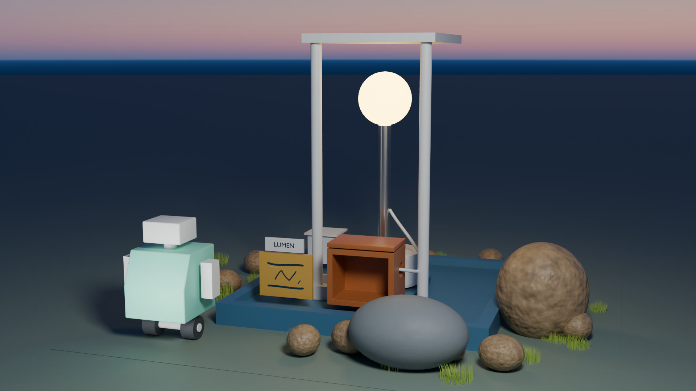

# Lecture 8: Assets, Geometry Nodes Scattering & Hair Curves

Turn one rock of the Lumen Field Station into a reusable stone asset, then build one Geometry Nodes graph that scatters it, and a groomed grass tuft, around the station. You learn what makes an asset reusable, file it in a local library with catalogs, compare Append, Link and a library override and fetch one online Essentials material. Then you build the scatter node by node, steer it with a distance mask, groom a static hair-curve tuft and scatter it as a second layer from the same graph.



The lecture is 1:02:30. Its video link will be added when published. [Full course playlist](https://www.youtube.com/playlist?list=PLYUs-JVhJLWg) · [course overview](../README.md)

## Files

The files were made with Blender 5.2.2 LTS; open them with Blender 5.2 or newer. Keep the folders together so the image paths and the library link resolve. Times identify the beginning of the save instruction; the saved file includes the completed action.

| File | What it is | Video |
|---|---|---|
| [`LumenCourse/blend/w08_station_work.blend`](LumenCourse/blend/w08_station_work.blend) | The station saved under a new name: the Lecture 7 baseline with the new `GEO_Stone`, a copy of the textured rock with its origin at its base and its scale applied (0.27 × 0.23 × 0.30 m). The lecture comes back to this file to build its graphs. | 5:28 Save As; opened again at 17:41 |
| [`LumenCourse/blend/w08_station_v001.blend`](LumenCourse/blend/w08_station_v001.blend) | Version one of the scatter, as saved last: `GN_StationScatter` on `GEO_Terrain` with its Distribution, Stone source, Variation and Mask frames, the guide surface `GEO_ScatterArea`, the studies in `W08_Studies` and the groomed grass tuft. The exposed controls and the second layer are added later, in version two. | 30:31 Save As; saved again at 51:45 |
| [`LumenCourse/blend/w08_station_v002.blend`](LumenCourse/blend/w08_station_v002.blend) | Version two, the final station of the lecture: the exposed controls and the second scatter layer with the grass tuft. It starts the next lecture, and it keeps the static tuft for the simulation lecture. | 1:00:25 Save As |
| [`LumenCourse/blend/w08_asset_test.blend`](LumenCourse/blend/w08_asset_test.blend) | The clean test file for reusing assets: a 4 m floor with the online `Concrete - Panels` material, the appended stone, the linked stone with its library override, the `Grass Tuft` collection and the `W08_Sources` note. It links the stone from the library file below. | 10:22 Save As; saved again at 12:44, 17:26 and 1:01:20 |
| [`LumenCourse/assets/w08_assets.blend`](LumenCourse/assets/w08_assets.blend) | The asset library file in its final state: the object asset `GEO_Stone` (catalog Environment/Rocks, four packed images) and the collection asset `Grass Tuft` (catalog Environment/Plants), with the `W08_Assets` note | 8:17 Save As; saved again at 13:36 and 53:34 |
| [`LumenCourse/assets/blender_assets.cats.txt`](LumenCourse/assets/blender_assets.cats.txt) | The catalogs of the library folder: Environment, Environment/Rocks and Environment/Plants. Blender writes this file beside the library file. | 6:42, 6:51 and 53:10 |
| [`LumenCourse/textures/`](LumenCourse/textures/) | The station's image textures (1024 × 1024, with the two UDIM tiles of `station_tiles`); the stone and the station read them | |
| `LumenCourse/audio`, `cache`, `exports`, `renders` | The rest of the project folder, empty for now | |
| [`checkpoints/`](checkpoints/) | A saved scene after each building step (see below) | |
| [`extras/w08_station_entry.blend`](extras/w08_station_entry.blend) | The station the lecture starts from: a copy of the final file from Lecture 7 | 1:32 |

The video registers the `LumenCourse/assets` folder as an asset library named `LumenCourse`, with Append as its default import method, in the chapter *A folder that becomes a library* (8:18): Edit > Preferences > Asset Libraries, plus, Add Local Asset Library. Do the same once with your own `assets` folder.

The scenes store their render output folder relative to the file (`//../renders/w07_motion_test/`, as saved in Lecture 7), so frames land in your own `LumenCourse/renders` when the file sits in `LumenCourse/blend`.

## Catch-up checkpoints

Missed a step, or want to start in the middle? Open a checkpoint, save a copy into your own `LumenCourse/blend` folder with **File > Save As**, and continue the video from the time shown. To keep your own window layout, untick **Load UI** in the **File > Open** dialog.

| Checkpoint | Scene state | Continue the video at |
|---|---|---|
| [`w08_checkpoint_01_origin_at_the_base.blend`](checkpoints/w08_checkpoint_01_origin_at_the_base.blend) | `BAKE_rock_low.001`, the copy one metre along X, with its origin at its base so it rests on the ground (Z 0) | 3:45 A sensible size and a clean name |
| [`w08_checkpoint_02_stone_asset_ready.blend`](checkpoints/w08_checkpoint_02_stone_asset_ready.blend) | `GEO_Stone`: the copy renamed and scaled by 0.35 with the scale applied (0.27 × 0.23 × 0.30 m), origin at its base | 5:29 A separate file for the asset |
| [`w08_checkpoint_03_asset_library_file.blend`](checkpoints/w08_checkpoint_03_asset_library_file.blend) | The library file as saved when the library chapters end: `GEO_Stone` marked as an asset in the `Environment/Rocks` catalog, its four images packed, the `W08_Assets` note. Save it as `LumenCourse/assets/w08_assets.blend` | 10:00 A clean test scene |
| [`w08_checkpoint_04_clean_test_scene.blend`](checkpoints/w08_checkpoint_04_clean_test_scene.blend) | The clean test file: a 4 m floor plane, the light and the camera | 11:00 Append a copy |
| [`w08_checkpoint_05_append_and_link.blend`](checkpoints/w08_checkpoint_05_append_and_link.blend) | `GEO_Stone` appended into the scene and a second `GEO_Stone` linked from `LumenCourse/assets/w08_assets.blend` | 12:23 A library override |
| [`w08_checkpoint_06_override_and_updated_source.blend`](checkpoints/w08_checkpoint_06_override_and_updated_source.blend) | The linked stone made a library override (`GEO_Stone.001`, Y 0.5) after the library stone was flattened and saved; the appended copy keeps its old height | 14:27 Allow online access |
| [`w08_checkpoint_07_online_material_and_sources_note.blend`](checkpoints/w08_checkpoint_07_online_material_and_sources_note.blend) | The floor with the `Concrete - Panels` material from the online Essentials library, stored in the file, and the `W08_Sources` note | 17:42 Back to the station, a screen for nodes |
| [`w08_checkpoint_08_first_graph_on_a_grid.blend`](checkpoints/w08_checkpoint_08_first_graph_on_a_grid.blend) | `W08_Studies` with `STUDY_GN_Grid` (a 2 m grid at X 7, Y -1, Z 0.5) and its first Geometry Nodes modifier, group `GN_FieldStudy` (Group Input to Group Output) | 20:02 One operation in the graph |
| [`w08_checkpoint_09_field_study.blend`](checkpoints/w08_checkpoint_09_field_study.blend) | `GN_FieldStudy` with Set Position: the X position, multiplied by 0.3, offsets Z | 23:19 The stone from our library |
| [`w08_checkpoint_10_library_stone_in_the_station.blend`](checkpoints/w08_checkpoint_10_library_stone_in_the_station.blend) | `SRC_Scatter` holds `GEO_Stone` appended from the library, the flatter stone (0.27 × 0.23 × 0.21 m) | 24:17 A copy of the minimal graph |
| [`w08_checkpoint_11_object_info_original.blend`](checkpoints/w08_checkpoint_11_object_info_original.blend) | `STUDY_InfoGrid` with `GN_ObjectInfoStudy`: Object Info of `GEO_Stone` (Original, As Instance off) wired to the Group Output, so the object shows the stone itself | 26:38 Instance or real geometry |
| [`w08_checkpoint_12_object_info_as_instance.blend`](checkpoints/w08_checkpoint_12_object_info_as_instance.blend) | `GN_ObjectInfoStudy` with As Instance on: the stone arrives as an instance instead of real geometry | 27:12 A graph on the terrain |
| [`w08_checkpoint_13_a_stone_on_every_point.blend`](checkpoints/w08_checkpoint_13_a_stone_on_every_point.blend) | `GEO_Terrain` with `GN_StationScatter`: Distribute Points on Faces, Instance on Points and Object Info (`GEO_Stone` as the instance) | 29:16 Join Geometry |
| [`w08_checkpoint_14_scatter_graph_with_frames.blend`](checkpoints/w08_checkpoint_14_scatter_graph_with_frames.blend) | Join Geometry added, the frames Distribution and Stone source named, density 0.5 | 30:31 A checkpoint and the numbers |
| [`w08_checkpoint_15_rotation_scale_and_turn.blend`](checkpoints/w08_checkpoint_15_rotation_scale_and_turn.blend) | Frame Variation: Random Value scale 0.7 to 1.3 and a random turn about Z through Rotate Rotation; density 0.5 | 35:19 A separate surface for the scatter |
| [`w08_checkpoint_16_guide_surface_and_density.blend`](checkpoints/w08_checkpoint_16_guide_surface_and_density.blend) | `GEO_ScatterArea` (hidden, render off) feeds Distribute Points on Faces through Object Info (Relative); density 2; `W08_Studies` and `SRC_Scatter` disabled for rendering | 37:43 Distance to the platform |
| [`w08_checkpoint_17_proximity_mask.blend`](checkpoints/w08_checkpoint_17_proximity_mask.blend) | Frame Mask: Geometry Proximity to `GEO_Platform`, Map Range 0.1 to 0.9 m, multiplied by 3 into the density | 41:16 A study grid and its target |
| [`w08_checkpoint_18_mask_study_in_a_material.blend`](checkpoints/w08_checkpoint_18_mask_study_in_a_material.blend) | `STUDY_MaskGrid` and `STUDY_MaskCube` with `GN_MaskStudy` (Geometry Proximity, Map Range 0 to 0.5 m, Store Named Attribute `course_mask`) and `MAT_MaskStudy` | 46:40 A small round surface with UVs |
| [`w08_checkpoint_19_tuft_patch.blend`](checkpoints/w08_checkpoint_19_tuft_patch.blend) | `GEO_TuftPatch`: a round patch (radius 0.1 m) with a UV map, at X 7, Y -8, Z 0.02 | 47:37 Empty hair |
| [`w08_checkpoint_20_guides_combed_and_shortened.blend`](checkpoints/w08_checkpoint_20_guides_combed_and_shortened.blend) | `HAIR_GrassTuft`: twelve guide curves on the patch, combed and shortened | 49:12 Density, thickness and colour |
| [`w08_checkpoint_21_groomed_tuft.blend`](checkpoints/w08_checkpoint_21_groomed_tuft.blend) | The tuft with Interpolate Hair Curves (density 5000), Set Hair Curve Profile and a green material; the bend test removed again | 51:36 The tuft into the library |
| [`w08_checkpoint_22_exposed_controls.blend`](checkpoints/w08_checkpoint_22_exposed_controls.blend) | `GN_StationScatter` exposes Density 3, Seed 0, Scale Min 0.7, Scale Max 1.3 and Instance Object on the modifier | 56:45 Use the controls |
| [`w08_checkpoint_23_second_layer.blend`](checkpoints/w08_checkpoint_23_second_layer.blend) | A second modifier on `GEO_Terrain`, `GeometryNodes.001`, reuses `GN_StationScatter` with the tuft as Instance Object (Density 8, Seed 5) | 59:50 Acceptance check and the saved state |

To build from the start (1:32), open `extras/w08_station_entry.blend` and save a working copy into `LumenCourse/blend`.

Checkpoint 03 is the library file itself: save it as `LumenCourse/assets/w08_assets.blend`. Checkpoints 05, 06 and 07 link their stone from that file, and the `LumenCourse/assets/w08_assets.blend` of this repository is the final library (the flatter stone and the `Grass Tuft`). Checkpoint 05 was made while the library stone still had its original height, so save checkpoint 03 as your library file before you open it; checkpoints 06 and 07 match the final library file.

## Check your scene

Values of version two, `w08_station_v002.blend`, read from the file. Unit system: **METRIC**, scale **1**; 1 Blender unit is 1 metre. Everything from Lecture 7 is unchanged (the camera, the lights, the world and the render settings: 3840 × 2160 at 50 %, Cycles, 128 samples, AgX) except that `GEO_Terrain` gains the scatter modifiers.

| Object | Collection | Location X, Y, Z (m) | Values in the file |
|---|---|---|---|
| GEO_Stone | SRC_Scatter | 9.0062, -2.0042, 0.002 | The library stone appended into the station: 0.2726 × 0.2321 × 0.2107 m, 642 vertices, material `MAT_Rock_Export.001`. The collection is hidden in the viewport and disabled for rendering; its instances still show. |
| GEO_Terrain | W04_INPUTS | 0, 0, 0.002 | The scatter host, 4.4 × 4.4 m (1,089 vertices). Two Geometry Nodes modifiers use `GN_StationScatter`: `GeometryNodes` with Density 3, Seed 0, Scale Min 0.7, Scale Max 1.3 and Instance Object `GEO_Stone`, and `GeometryNodes.001` with Density 8, Seed 5, Scale Min 0.7, Scale Max 1.3 and Instance Object `HAIR_GrassTuft` |
| GEO_ScatterArea | W04_INPUTS | 0, 0, 0.002 | The guide surface the points are distributed on: a copy of `GEO_Terrain` with 568 of its 1,024 faces left; disabled for rendering |
| STUDY_GN_Grid | W08_Studies | 7, -1, 0.5 | A 2 × 2 m grid (121 vertices) with `GN_FieldStudy`: the X of Position, multiplied by 0.3, becomes the Z of the Set Position offset, so the grid rises 0.6 m |
| STUDY_InfoGrid | W08_Studies | 7, -3, 0.5 | A grid with `GN_ObjectInfoStudy`: Object Info of `GEO_Stone` (Original, As Instance) and Realize Instances |
| STUDY_MaskGrid | W08_Studies | 7, -5, 0.02 | A 2 × 2 m grid (2,601 vertices) with `GN_MaskStudy`: Object Info of `STUDY_MaskCube` (Relative), Geometry Proximity, Map Range (0 to 0.5 m onto 1 to 0, clamped) and Store Named Attribute `course_mask`. Material `MAT_MaskStudy`: Attribute `course_mask` into a Color Ramp into the Material Output. |
| STUDY_MaskCube | W08_Studies | 7.5, -5, 0.17 | A 0.3 m cube the mask measures its distance to |
| GEO_TuftPatch | W08_Studies | 7, -8, 0.02 | The round patch for the tuft: 0.2 × 0.2 m (radius 0.1 m, 33 vertices) with a UV map and a `Capture Rest Geometry` modifier |
| HAIR_GrassTuft | W08_Studies | Child of `GEO_TuftPatch` | Hair curves on the patch (surface UV map `UVMap`): 12 guide curves, 96 points. Modifiers: Interpolate Hair Curves (Density 5000, 4 interpolation guides, Seed 0), Set Hair Curve Profile (Radius 0.0015 m, Shape 0.5) and Hair Dynamics (Mode Animation, as created). Material `Material`: Base Color #A8C94E. |

`GN_StationScatter` (20 nodes) is grouped in four frames; the modifier's Density, Seed, Scale Min, Scale Max and Instance Object are the group's exposed inputs.

| Part of the graph | Nodes and values |
|---|---|
| Guide surface | Object Info of `GEO_ScatterArea` (Relative) feeds the Mesh of Distribute Points on Faces |
| Frame Distribution | Distribute Points on Faces (Random). Its Density is the exposed Density multiplied by the mask (Math, Multiply); its Seed is the exposed Seed. |
| Frame Stone source | Object Info of the exposed Instance Object (Original, As Instance) into Instance on Points |
| Frame Variation | Random Value (Float) between the exposed Scale Min and Scale Max into the Scale of Instance on Points; Random Value (Float, 0 to 6.2832) into Combine XYZ (Z), Euler to Rotation and Rotate Rotation (Local) on the points' rotation, into the Rotation of Instance on Points |
| Frame Mask | Object Info of `GEO_Platform` (Relative) as the Target of Geometry Proximity; its Distance into Map Range (From Min 0.1, From Max 0.9, To Min 1, To Max 0, clamped), then Math (Multiply) with the Density |
| Output | Join Geometry combines the terrain from Group Input with the instances and feeds Group Output |

`SRC_Scatter` and `W08_Studies` are disabled for rendering, `SRC_Scatter` is also hidden in the viewport, and `W07_Volume_Study` stays excluded from the view layer as in Lecture 7.

The library file `LumenCourse/assets/w08_assets.blend` holds the object asset `GEO_Stone` (catalog Environment/Rocks; 0.2726 × 0.2321 × 0.2107 m after the flattening, with four packed 1024 × 1024 images) and the collection asset `Grass Tuft` (catalog Environment/Plants) with `GEO_TuftPatch` and `HAIR_GrassTuft`. Its `W08_Assets` text reads:

```text
GEO_Stone: field stone, about 0.3 m tall
Origin at base, +Z up, scale applied
MAT_Rock_Export, 4 images packed
Use: scatter around the station
```

The test file `w08_asset_test.blend` (1920 × 1080) holds `Plane` (4 × 4 m) with the `Concrete - Panels` material, `GEO_Stone` appended at -0.7716, -0.0099, 0.0028 (0.2726 × 0.2321 × 0.301 m), `GEO_Stone.001`, the library override of the linked stone at 0, 0.5, 0 (0.2107 m tall), the `Grass Tuft` collection, `Light` and `Camera`. Its `W08_Sources` text reads:

```text
Concrete - Panels, Blender Studio
Online Essentials, stored in this file
```

## Chapters

<details>
<summary>All 66 chapters of the video</summary>

- 0:00 The station, scattered by a graph
- 0:58 The graph behind it
- 1:48 A rock worth reusing
- 2:46 The origin belongs at the base
- 3:45 A sensible size and a clean name
- 4:39 What travels with the stone
- 5:29 A separate file for the asset
- 6:14 Mark it as an asset
- 7:10 Pack the images and write a manifest
- 8:18 A folder that becomes a library
- 9:36 The library in the Asset Browser
- 10:00 A clean test scene
- 11:00 Append a copy
- 11:39 Link a reference
- 12:23 A library override
- 12:52 Improve the source
- 13:58 What propagates
- 14:27 Allow online access
- 14:53 Browse, then fetch one
- 15:57 Where the file lives
- 16:19 Offline, the asset stays
- 17:42 Back to the station, a screen for nodes
- 18:34 A test grid and its first graph
- 20:02 One operation in the graph
- 20:50 What the graph produces
- 21:14 A value per vertex
- 22:56 A field needs a context
- 23:19 The stone from our library
- 24:17 A copy of the minimal graph
- 25:13 Object Info, Original or Relative
- 26:38 Instance or real geometry
- 27:12 A graph on the terrain
- 27:44 Points on the terrain
- 28:19 A stone on every point
- 29:16 Join Geometry
- 29:48 Frames and the seed
- 30:31 A checkpoint and the numbers
- 31:55 Orientation from the surface
- 32:18 Random scale
- 33:10 A random turn
- 35:19 A separate surface for the scatter
- 36:39 Distribute on the guide surface
- 37:25 Two densities from the camera
- 37:43 Distance to the platform
- 39:18 Inspect it before using it
- 40:00 Use the mask
- 41:16 A study grid and its target
- 42:51 The same mask recipe
- 44:11 Store the mask
- 44:52 Read the mask in a material
- 46:40 A small round surface with UVs
- 47:37 Empty hair
- 48:10 Guides with the Add brush
- 48:39 Comb and shorten
- 49:12 Density, thickness and colour
- 50:53 Is it really attached?
- 51:36 The tuft into the library
- 52:58 Filed under Plants
- 54:05 Expose the controls
- 56:45 Use the controls
- 57:02 A preset for comparison
- 58:06 Realize Instances compared
- 58:48 A second layer from the same rules
- 59:50 Acceptance check and the saved state
- 1:00:39 The clean test scene
- 1:01:35 Questions and the next lecture

</details>

## Links

- Official Blender download: https://www.blender.org/download/
- Blender manual: https://docs.blender.org/manual/en/latest/
- Screencast Keys, the add-on that shows the pressed keys in the video: https://github.com/nutti/Screencast-Keys (no add-on is included here)

The `Concrete - Panels` material comes from the online Essentials library in Blender's Asset Browser (Blender Studio); Blender fetches it once you allow online access, in the chapter *Allow online access* (14:27).

Next: Lecture 9, Procedural Curves, Repeat Zones & Audio-Reactive Nodes, continues from `LumenCourse/blend/w08_station_v002.blend`: the same ideas, fields, instances and exposed controls, become a procedural signal display that responds to sound. Keep version two, the asset library and its catalogs together in your `LumenCourse` folder.
