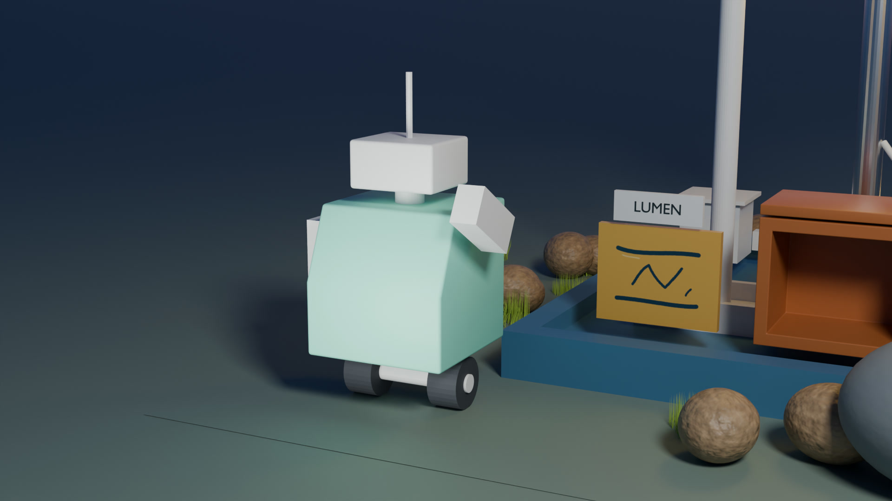

# Lecture 10: Rigging, Weights, IK, Drivers & Shape Keys

Give the courier of the Lumen Field Station a simple rig: seven bones that pose it as one character. Build the rest structure in Edit Mode, pose it in Pose Mode, name left and right from the character's own view and attach every rigid part to its bone, with the wheels on the root, outside the body's branch. Then bend a segmented antenna with vertex weights, close an eyelid with shape keys, limit the head's turn with a constraint, solve an arm study with IK, drive a turn and a blink from custom properties, and stress-test the rig in three poses before saving it neutral for the animation lecture.

The lecture is 43:50. Its video link will be added when published. [Full course playlist](https://www.youtube.com/playlist?list=PLYUs-JVhJLWg) · [course overview](../README.md)

## Files

The files were made with Blender 5.2.2 LTS; open them with Blender 5.2 or newer. The signal sound is packed into every .blend file, so a single downloaded file also opens; keep the folders together so the image paths resolve. Times identify the beginning of the save instruction; the saved file includes the completed action.

| File | What it is | Video |
|---|---|---|
| [`LumenCourse/blend/w10_station_work.blend`](LumenCourse/blend/w10_station_work.blend) | Lecture 9's final station saved under a new name before rigging starts; nothing else is saved into it in the video, so it holds the Lecture 9 station unchanged | 2:12 Save As |
| [`LumenCourse/blend/w10_station_rest.blend`](LumenCourse/blend/w10_station_rest.blend) | The rest checkpoint: `RIG_Courier` with root, body, head and both arm bones, and the arm study `RIG_ArmStudy` (upper arm and forearm), before any mesh is attached | 12:53 Save As |
| [`LumenCourse/blend/w10_station_v001.blend`](LumenCourse/blend/w10_station_v001.blend) | Version one: the parts on their bones, the antenna with two deform bones and painted weights, the Blink shape key, then the head's rotation limit and the IK arm study, in the neutral pose | 26:58 Save As; saved again at 32:06 |
| [`LumenCourse/blend/w10_driver_test.blend`](LumenCourse/blend/w10_driver_test.blend) | The driver test copy of version one: the custom property `head_turn` (−1 to 1) on `RIG_Courier` drives the head bone's Rotation Y with `var * 0.6` | 32:29 Save As; saved again at 34:53 |
| [`LumenCourse/blend/w10_station_v002.blend`](LumenCourse/blend/w10_station_v002.blend) | Version two, the final file of the lecture and the start of the next: adds the Squint key, the `blink` property that drives Blink, the root's ring shape and the locked body location; saved in the neutral pose | 42:45 Save As |
| [`LumenCourse/renders/w10_pose_neutral.png`](LumenCourse/renders/w10_pose_neutral.png) | Save Screenshot (Editor) of the viewport: the rig at rest | 39:54 |
| [`LumenCourse/renders/w10_pose_turn.png`](LumenCourse/renders/w10_pose_turn.png) | The maximum turn: the root turned 80° toward the beacon and the head at its limit | 40:53 |
| [`LumenCourse/renders/w10_pose_wave.png`](LumenCourse/renders/w10_pose_wave.png) | The wave: `arm.L` rotated −120° about X | 41:25 |
| [`LumenCourse/audio/Lumen_signal_10s.wav`](LumenCourse/audio/Lumen_signal_10s.wav) | Lecture 9's sound, which the signal display still uses | |
| [`LumenCourse/textures/`](LumenCourse/textures/) | The station's image textures (1024 × 1024, with the two UDIM tiles of `station_tiles`), as in Lecture 9 | |
| `LumenCourse/cache`, `exports` | The rest of the project folder, empty for now | |
| [`checkpoints/`](checkpoints/) | A saved scene after each building step (see below) | |
| [`extras/w09_station_v002.blend`](extras/w09_station_v002.blend) | The station the lecture starts from: the final file of Lecture 9, unchanged | 1:50 |

The driver test stays a separate study: version one is reopened at 34:53 and keeps the head without a driver, so `w10_station_v002.blend` has no `head_turn`.

The screenshots show the Screencast Keys mouse icon of the recording; they are the pictures exactly as saved in the video.

The scenes store their render output folder relative to the file (`//../renders/w07_motion_test/`, as saved in Lecture 7), so frames land in your own `LumenCourse/renders` when the file sits in `LumenCourse/blend`.

## Catch-up checkpoints

Missed a step, or want to start in the middle? Open a checkpoint, save a copy into your own `LumenCourse/blend` folder with **File > Save As**, and continue the video from the time shown. To keep your own window layout, untick **Load UI** in the **File > Open** dialog. Keep `checkpoints` and `LumenCourse` side by side so the sound and textures resolve. Some checkpoints open in Edit or Pose Mode, as the video was at that moment.

| Checkpoint | Scene state | Continue the video at |
|---|---|---|
| [`w10_checkpoint_01_root_body_and_head.blend`](checkpoints/w10_checkpoint_01_root_body_and_head.blend) | `RIG_Courier` at (−1.4, −1.6, 0) with `root` lying flat and pointing back, `body` (parent root, Keep Offset) and `head` connected to the body's tail; Edit Mode | 6:31 Pose Mode: a pose, not a new rest |
| [`w10_checkpoint_02_arm_bones_symmetrized.blend`](checkpoints/w10_checkpoint_02_arm_bones_symmetrized.blend) | `arm.L` from the shoulder (0.36, 0, 0.68) down to 0.38 m, parent body with Keep Offset; `arm.R` made by Symmetrize at X −0.36; bone names shown | 9:41 Predict which bones follow |
| [`w10_checkpoint_03_arm_study.blend`](checkpoints/w10_checkpoint_03_arm_study.blend) | `RIG_ArmStudy` at (−2.6, −1.6, 0) in the new collection `W10_Studies`: `upper` (0.95 to 0.68 m, its tail 0.03 m forward) and the connected `forearm` down to 0.42 m | 11:42 Roll decides the bone's axes |
| [`w10_checkpoint_04_body_head_and_arms_on_bones.blend`](checkpoints/w10_checkpoint_04_body_head_and_arms_on_bones.blend) | Rigid parts parented with Control P › Bone: `CR_body` to body, `CR_head` and `CR_neck` to head, `CR_arm_R` to `arm.L`, `CR_arm_L` to `arm.R` | 15:49 Wheels outside the body branch |
| [`w10_checkpoint_05_wheels_on_the_root.blend`](checkpoints/w10_checkpoint_05_wheels_on_the_root.blend) | `CR_foot_L`, `CR_foot_R`, `CR_axle` and `CR_chassis` on the root bone, outside the body branch; every bone cleared to neutral | 18:58 A segmented antenna |
| [`w10_checkpoint_06_antenna_and_deform_bones.blend`](checkpoints/w10_checkpoint_06_antenna_and_deform_bones.blend) | `CR_antenna`, an 8-vertex cylinder, radius 0.012 m, depth 0.24 m, on the head with 7 loop cuts (8 segments); `antenna.01` (1.01 to 1.13 m) and `antenna.02` (1.13 to 1.25 m) extruded from the head's tail; Edit Mode | 20:47 Armature modifier and empty groups |
| [`w10_checkpoint_07_rigid_antenna_groups.blend`](checkpoints/w10_checkpoint_07_rigid_antenna_groups.blend) | Armature Deform: an Armature modifier on `CR_antenna`, parented to `RIG_Courier`; vertex groups `antenna.01` (lower five rings) and `antenna.02` (upper four rings) at weight 1; `antenna.02` still rotated 30°, the sharp fold | 22:53 A graduated transition by painting |
| [`w10_checkpoint_08_painted_antenna_weights.blend`](checkpoints/w10_checkpoint_08_painted_antenna_weights.blend) | `antenna.02` painted at weight 0.5 across the middle rings, so the bend spreads over several rings; the antenna back at rest | 24:14 Shape keys on the eyelid |
| [`w10_checkpoint_09_blink_shape_key.blend`](checkpoints/w10_checkpoint_09_blink_shape_key.blend) | `RETOPO_Eyelid_Neutral` (collection `W04_HEAD` shown) with the keys Basis and Blink: the lid turned down around the eye's centre and scaled up 10 %; Blink at 0, the pivot back to Median Point | 26:58 Version one and a clean pose |
| [`w10_checkpoint_10_head_rotation_limit.blend`](checkpoints/w10_checkpoint_10_head_rotation_limit.blend) | Limit Rotation on the head bone: Y from −60° to 60°, Local Space | 28:52 Target and pole bones |
| [`w10_checkpoint_11_ik_target_and_pole.blend`](checkpoints/w10_checkpoint_11_ik_target_and_pole.blend) | `ik_target` (0.42 to 0.32 m at the wrist) and `ik_pole` (0.35 m in front of the elbow, 0.68 to 0.58 m) in `RIG_ArmStudy`, with no parents; Edit Mode | 30:14 The IK constraint |
| [`w10_checkpoint_12_ik_constraint.blend`](checkpoints/w10_checkpoint_12_ik_constraint.blend) | An IK constraint on `forearm`: target `ik_target`, pole target `ik_pole`, Pole Angle −90°, Chain Length 2 | 31:13 IK or FK |
| [`w10_checkpoint_13_squint_and_blink_driver.blend`](checkpoints/w10_checkpoint_13_squint_and_blink_driver.blend) | Version one reopened, then a second key Squint (the lid turned 15°) and a custom property `blink` (0 to 1) on `RIG_Courier` that drives the Blink value with the expression `var`; Squint keeps its own slider | 38:25 A findable root and a locked channel |
| [`w10_checkpoint_14_root_shape_and_locked_body.blend`](checkpoints/w10_checkpoint_14_root_shape_and_locked_body.blend) | `WGT_root`, a 32-vertex circle of radius 1.3 in the collection `WGT` (hidden, disabled for rendering), as the root bone's custom shape; the body bone's location channels locked | 39:54 Three poses |

The lesson files continue the same way: `w10_station_rest.blend` at 13:16 (*The body on its bone*) and `w10_station_v001.blend` at 32:14 (*A test copy and a custom property*).

To build from the start (1:50), open `extras/w09_station_v002.blend` and save a working copy into `LumenCourse/blend`, as the video does at 2:12.

## Check your scene

Values of version two, `w10_station_v002.blend`, read from the file. Unit system: **METRIC**, scale **1**; 1 Blender unit is 1 metre. The render settings are those of Lecture 9: camera `CAM_hero`, 3840 × 2160 at 50 %, Cycles, 128 samples, AgX; 24 fps, frames 1 to 240. The file is saved in Object Mode with every bone at rest.

`RIG_Courier` (collection `COLLECTION_COURIER`) sits at (−1.4, −1.6, 0) with rotation 0 and scale 1. In Front and Names are on. Its seven bones, in armature space (metres), all with roll 0:

| Bone | Head | Tail | Parent | Values in the file |
|---|---|---|---|---|
| root | 0, 0, 0 | 0, 0.35, 0 | none | Custom shape `WGT_root` |
| body | 0, 0, 0.22 | 0, 0, 0.77 | root (offset) | Location X, Y and Z locked |
| head | 0, 0, 0.77 | 0, 0, 1.01 | body (connected) | Limit Rotation: Y −60° to 60°, Local Space |
| antenna.01 | 0, 0, 1.01 | 0, 0, 1.13 | head (connected) | Deforms `CR_antenna` |
| antenna.02 | 0, 0, 1.13 | 0, 0, 1.25 | antenna.01 (connected) | Deforms `CR_antenna` |
| arm.L | 0.36, 0, 0.68 | 0.36, 0, 0.38 | body (offset) | Carries `CR_arm_R`, the part on +X |
| arm.R | −0.36, 0, 0.68 | −0.36, 0, 0.38 | body (offset) | Carries `CR_arm_L`, the part on −X |

The courier faces −Y, toward the hero camera, so its own left arm is the part on +X that Lecture 3 named `CR_arm_R`; the bones follow the character and the objects keep their names.

| Part | Parent | Location X, Y, Z (m) | Dimensions (m) |
|---|---|---|---|
| CR_body | bone body | −1.4, −1.6, 0.495 | 0.55 × 0.55 × 0.55, from 0.22 to 0.77 m high |
| CR_neck | bone head | −1.4, −1.6, 0.79 | 0.11 × 0.11 × 0.08 |
| CR_head | bone head | −1.4, −1.6, 0.92 | 0.34 × 0.3 × 0.18 |
| CR_arm_R | bone arm.L | −1.04, −1.6, 0.68 | 0.1 × 0.14 × 0.3 |
| CR_arm_L | bone arm.R | −1.76, −1.6, 0.68 | 0.1 × 0.14 × 0.3 |
| CR_foot_L, CR_foot_R | bone root | −1.58 and −1.22, −1.6, 0.1 | 0.2 × 0.2 × 0.12, from the ground to 0.2 m |
| CR_axle | bone root | −1.4, −1.6, 0.1 | 0.07 × 0.07 × 0.5 |
| CR_chassis | bone root | −1.4, −1.6, 0.2 | 0.2 × 0.1 × 0.2 |
| CR_antenna | object RIG_Courier, Armature modifier | −1.4, −1.6, 1.13 | 0.024 × 0.024 × 0.24, from 1.01 to 1.25 m; 72 vertices |

Weights of `CR_antenna`, ring by ring from the bottom (eight vertices each, read from the file): rings 1 to 5 carry `antenna.01` at 1; `antenna.02` reads 0.007, 0.372 and 0.466 on rings 3 to 5, then 0.849 on ring 6 and 1 on rings 7 to 9. Rings 3 to 5 share the bend between both bones.

| Study or control | Values in the file |
|---|---|
| `RIG_ArmStudy` (collection `W10_Studies`, at −2.6, −1.6, 0; Axes shown) | `upper` (0, 0, 0.95) → (0, −0.03, 0.68); `forearm` connected → (0, −0.03, 0.42); `ik_target` (0, −0.03, 0.42) → (0, −0.03, 0.32) and `ik_pole` (0, −0.35, 0.68) → (0, −0.35, 0.58), no parents. IK on `forearm`: target `ik_target`, pole `ik_pole`, Pole Angle −90°, Chain Length 2 |
| `RETOPO_Eyelid_Neutral` (collection `W04_HEAD`, disabled for rendering) | Shape keys Basis, Blink and Squint, both relative to Basis and at 0; Blink moves a vertex at most 0.062 m, Squint 0.029 m. Blink's value has a driver: expression `var`, a Single Property of `RIG_Courier`, path `["blink"]` |
| Custom property `blink` on `RIG_Courier` | 0, range 0 to 1, default 0 |
| `WGT_root` (collection `WGT`, hidden and disabled for rendering) | A circle of 32 vertices, radius 1.3 m; on the 0.35 m root bone it draws as a ring of about 0.45 m radius around the courier's base |
| `head_turn` (only in `w10_driver_test.blend`) | Range −1 to 1; the head's rotation mode XYZ Euler; driver on Rotation Y: `var * 0.6`, so −1 and 1 give −0.6 and 0.6 rad (about ±34.4°) |

The rig carries no keyframes: the only action in the file is Lecture 7's camera move.

## Chapters

All 39 chapters of the video

- 0:00 A courier that poses
- 1:50 Back to last week's station
- 2:12 A file and a view for rigging
- 3:33 An armature at the courier's feet
- 4:37 Edit Mode: the root bone
- 5:24 Body and head
- 6:31 Pose Mode: a pose, not a new rest
- 7:24 One control for the whole character
- 8:01 An arm bone
- 8:47 Symmetrize and check the names
- 9:41 Predict which bones follow
- 10:21 A separate arm study
- 11:42 Roll decides the bone's axes
- 12:53 A rest checkpoint
- 13:16 The body on its bone
- 14:01 Head and neck
- 14:46 The arms
- 15:49 Wheels outside the body branch
- 17:15 Working-scene checks and the hop
- 18:58 A segmented antenna
- 20:00 Two deform bones
- 20:47 Armature modifier and empty groups
- 21:35 Rigid weights first
- 22:53 A graduated transition by painting
- 24:14 Shape keys on the eyelid
- 25:35 Shaping Blink
- 26:58 Version one and a clean pose
- 27:51 A rotation limit
- 28:52 Target and pole bones
- 30:14 The IK constraint
- 31:13 IK or FK
- 32:14 A test copy and a custom property
- 33:15 The driver
- 34:02 Test and document
- 35:10 Expression controls
- 38:25 A findable root and a locked channel
- 39:54 Three poses
- 41:49 Through the docking area
- 42:45 Version two and next week

## Links

- Official Blender download: https://www.blender.org/download/
- Blender manual: https://docs.blender.org/manual/en/latest/
- Screencast Keys, the add-on that shows the pressed keys in the video: https://github.com/nutti/Screencast-Keys (no add-on is included here)

Next: Lecture 11, Animation, Graph Editor, NLA & Seamless Loops, continues from `LumenCourse/blend/w10_station_v002.blend` and gives the courier's poses timing and spacing: the hop, the look toward the signal and the settle. Keep version two and the `audio` folder together in your `LumenCourse` folder.
